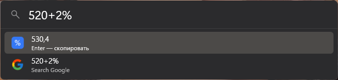
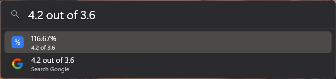
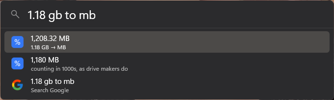
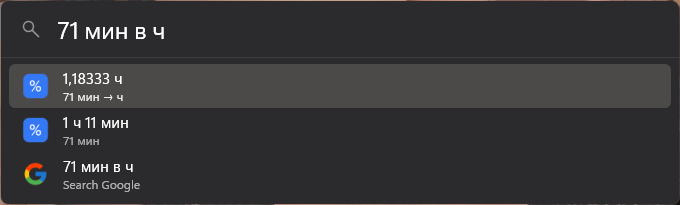

<p align="center"></p>

<h1 align="center">Smart Calc</h1>

<p align="center">A <a href="https://www.flowlauncher.com">Flow Launcher</a> calculator that understands what you type into Google:<br>percentages, “x of y”, percent change and unit conversion, in English and Russian.</p>

<p align="center">
  
  
  
  
</p>

## What it understands

| You type | You get |
|---|---|
| `520+2%` · `520-2%` | 530.4 · 509.6 (adds or takes 2% *of 520*, like Google) |
| `90*200*15%` · `50/10%` | 2,700 · 500 |
| `15% of 200` · `15% от 200` | 30 |
| `4.2 out of 3.6` · `what percent is 30 of 120` · `4,2 от 3,6 в %` | 116.67% · 25% · 116,67 % |
| `from 1220 to 1385` · `от 1220 до 1385` | +13.52%, difference 165 |
| `45/60 in %` | 75% |
| `71 min to h` · `71 min` | 1.18333 h and 1 h 11 min |
| `1.18 gb to mb` | 1,208.32 MB, and 1,180 MB counting in 1000s as drive makers do |
| `100 mbps to mb/s` | 11.9209 MB/s |
| `36.6 c to f` · `10 km in mi` · `2 kg to lb` · `60 km/h to m/s` · `6 ares to m2` | temperature, length, mass, speed, area |
| `sqrt(16)+2` · `2^10` · `5!` · `sin(30°)` · `round(3.14159, 2)` | the usual maths |
| `1 385-1220` · `1,18*1024` · `1920x1080` | spaces in numbers, decimal comma, `x` for times |

Units: time (ms to years), data (bits, bytes, KB to TB in powers of 1024 like Windows, network speeds in powers of 1000), length, mass, volume, area, speed and temperature, in English and Russian spelling (`мин`, `гб`, `км/ч`, `соток`).

**Enter** copies the number. The context menu (**Shift+Enter**) copies it with the other decimal separator.

### Answer language

The answer follows the query: Russian words get a Russian answer (`1 208,32 МБ`), English words an English one (`1,208.32 MB`). Bare arithmetic like `520+2%` uses the number format from Windows' regional settings.

### Next to the built-in Calculator

If Flow's own Calculator plugin is enabled, Smart Calc leaves plain arithmetic like `2+2` to it and answers only what it cannot do: percentages, phrases and units. Disable the built-in one in *Settings → Plugins* to have Smart Calc answer everything in one style.

## Install

In Flow Launcher:

```
pm install Smart Calc
```

Until the store listing goes live, install the latest release directly:

```
pm install https://github.com/renkagod/Flow.Launcher.Plugin.SmartCalc/releases/latest/download/Flow.Launcher.Plugin.SmartCalc.zip
```

## Build

Needs the .NET 9 SDK.

```powershell
dotnet run --project tests                                    # engine checks, no Flow needed
dotnet build Flow.Launcher.Plugin.SmartCalc.csproj -c Release -o out
```

Copy `out` into `%APPDATA%\FlowLauncher\Plugins\Smart Calc` (or `UserData\Plugins` for a portable Flow) and restart Flow.

To release, bump `Version` in `plugin.json` and push to `main`: the workflow tests, builds and publishes a release, and the plugin store updates from it.

## По-русски

Калькулятор для Flow Launcher, который считает, как Google: `520+2%` = 530,4, `4,2 от 3,6 в %`, `от 1220 до 1385`, `1,18 гб в мб`, `71 мин в ч`, `100 мбит/с в мб/с`, `6 соток в м2`. Отвечает на языке запроса. Enter копирует число, в контекстном меню можно скопировать его с точкой.

## License

[MIT](LICENSE)
